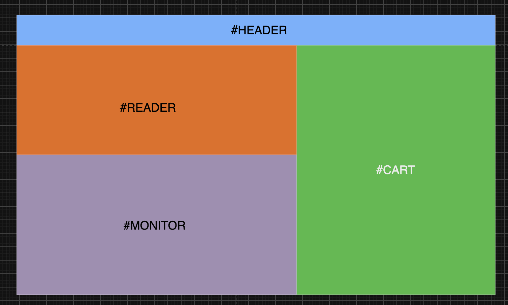
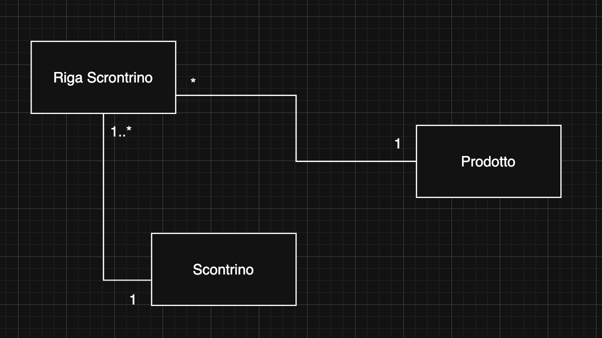

# Cassa Automatica

Applicazione full-stack che simula una cassa self-service: il cliente apre un carrello, acquisisce i prodotti tramite fotocamera o codice a barre inserito manualmente e conclude il pagamento con il totale calcolato in tempo reale.

Il progetto è pensato come dimostrazione di un flusso e-commerce/POS essenziale, con un backend REST in Java e un'interfaccia web leggera, senza framework lato client.



## Caratteristiche

- Apertura e chiusura di un carrello
- Lettura di codici a barre dalla fotocamera
- Inserimento manuale del codice a barre
- Ricerca dei prodotti nel catalogo PostgreSQL
- Aggiornamento di quantità e totale in tempo reale
- Segnalazioni audio per scansione ed errore
- Gestione degli errori più comuni: carrello assente e codice non trovato

## Stack tecnologico

| Area | Tecnologie |
| --- | --- |
| Backend | Java 17, Spring Boot, Spring Web, Spring Data JPA |
| Database | PostgreSQL |
| Frontend | HTML, CSS, JavaScript vanilla |
| Scanner | html5-qrcode |
| Build | Maven |

## Architettura

Il backend espone un'API REST che coordina il carrello corrente e interroga il catalogo prodotti tramite JPA.

```text
Browser + scanner
       |
       v
Spring REST Controller
       |
       v
CassaService
       |
       v
ProdottoRepository --> PostgreSQL
```

### Modello di dominio

Lo scontrino raccoglie una o più righe; ogni riga fa riferimento a un prodotto del catalogo.



Le responsabilità principali sono:

- `CassaController`: espone gli endpoint HTTP della cassa.
- `CassaService`: gestisce lo stato del carrello, la scansione e il checkout.
- `ProdottoRepository`: accede al catalogo prodotti tramite Spring Data JPA.
- `Scontrino` e `RigaScontrino`: rappresentano il carrello e le sue righe.

## Avvio locale

### Prerequisiti

- Java 17 o superiore
- PostgreSQL 15 o superiore
- Un browser moderno con accesso alla fotocamera, se si vuole usare lo scanner

### 1. Prepara il database

Crea un database PostgreSQL chiamato `automatic_checkout` e configura un utente con accesso al database. Il backend usa di default la porta `5432` e l'utente `postgres`.

Le proprietà di connessione sono in [`backend/src/main/resources/application.properties`](backend/src/main/resources/application.properties). Mantieni la password fuori dal controllo versione, ad esempio tramite variabili d'ambiente o un file di configurazione locale non tracciato.

Esempio di tabella del catalogo:

```sql
CREATE TABLE prodotto (
  bar_code VARCHAR(255) PRIMARY KEY,
  product_name VARCHAR(255) NOT NULL,
  price DOUBLE PRECISION NOT NULL
);

INSERT INTO prodotto (bar_code, product_name, price) VALUES
  ('800123', 'Pasta Barilla 500g', 1.20),
  ('800456', 'Passata di Pomodoro', 1.50),
  ('800789', 'Acqua Naturale 1.5L', 0.40);
```

### 2. Avvia il backend

```bash
cd backend
./mvnw spring-boot:run
```

L'API sarà disponibile su `http://localhost:8080`.

### 3. Avvia il frontend

Servi la cartella `frontend` tramite un piccolo server HTTP locale. Per esempio:

```bash
cd frontend
python3 -m http.server 5500
```

Apri quindi `http://localhost:5500` nel browser e consenti l'accesso alla fotocamera quando richiesto.

## API

| Metodo | Endpoint | Descrizione |
| --- | --- | --- |
| `POST` | `/cassa-automatica/newCart` | Apre un nuovo carrello. |
| `POST` | `/cassa-automatica/scan/{barcode}` | Aggiunge il prodotto al carrello o incrementa la quantità. Restituisce lo scontrino aggiornato. |
| `POST` | `/cassa-automatica/checkout` | Calcola il totale e chiude il carrello corrente. |

### Esempio di scansione

```bash
curl -X POST http://localhost:8080/cassa-automatica/newCart
curl -X POST http://localhost:8080/cassa-automatica/scan/800123
curl -X POST http://localhost:8080/cassa-automatica/checkout
```

## Roadmap

- [ ] Rimuovere un prodotto dal carrello
- [ ] Gestire offerte e sconti percentuali
- [ ] Aggiungere un flusso per l'inserimento di prodotti nel catalogo
- [ ] Rendere persistenti gli scontrini

## Stato del progetto

Il progetto è una demo in evoluzione, pensata per mostrare la progettazione di un'applicazione POS essenziale e il collegamento tra frontend, API REST e database relazionale.
